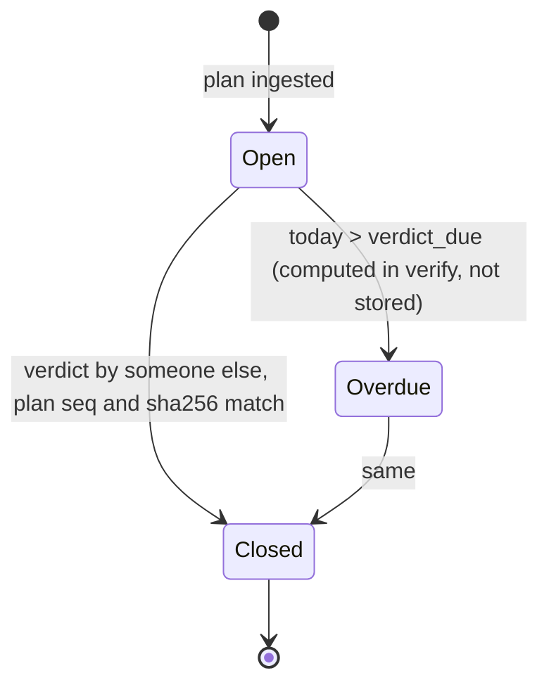
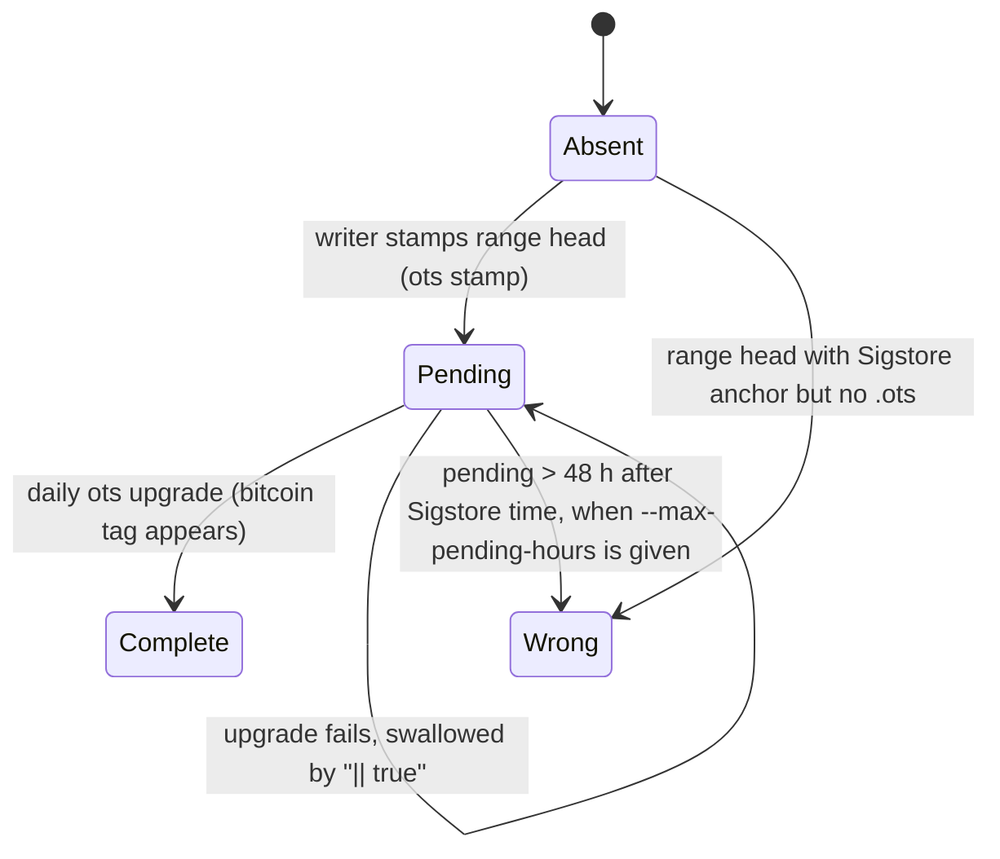
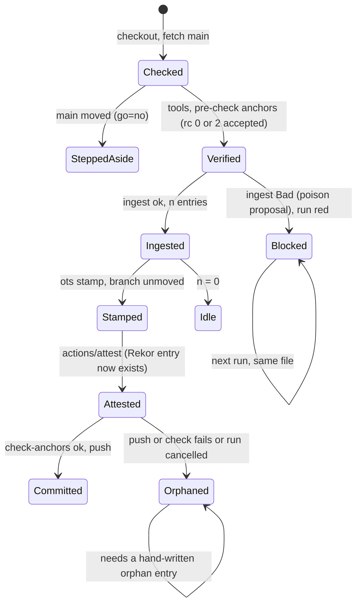

# Audit B: tests, bugs, hidden state machines

Repo: exagium, main @ e093a60 and pilot/lgn-20261115 @ 5bf0efe. Run 2026-11-17.
Method: skills test-design, bug-lifecycle, reproduce-before-filing, implicit-state-machines.
Scratch: /home/claude/audit/scratch/B/ (logs/, repro1-3/, mutate.py, calls.jsonl). Worktrees removed. No pushes, no triggers, no API calls.
Status words: **verified** = I ran a command and saw the output. **suspected** = from reading, or mechanism verified but occurrence not shown.

## 1. Test results

Command, per suite, from its own directory: `python3 -m unittest -v <module>`. (`python3 -I` fails by design here: it drops the cwd, so the test module is not importable. That was my harness, not a repo bug.)

| Suite | main | pilot/lgn-20261115 | Time main / pilot |
|---|---|---|---|
| counter/test_count.py | 23 run, 23 pass, 0 skip | 23 / 23 / 0 | 35 s / 74 s |
| loop/test_loop.py | 20 / 20 / 0 | 20 / 20 / 0 | 25 s / 33 s |
| probe/test_probe.py | 40 / 40 / 0 | 40 / 40 / 0 | 97 s / 70 s |
| record/test_record.py | 22 run, 21 pass, 1 skip | 22 / 21 / 1 | 0.3 s / 0.3 s |
| router/bench3,4,5 `decide.py selftest` (CI steps) | 3 of 3 print "selftest ok" | not run | s |
| **Total unittest** | **105 run, 104 pass, 1 skip, 0 fail** | same | |

- The one skip is `test_canonical_form_is_rfc8785`: "rfc8785 not installed". The RFC 8785 oracle test never runs here. Check whether CI installs `rfc8785`: `record.yml` does not, and no workflow runs `test_record` except via fix-commit copies. Suspected gap (T1).
- main..pilot differs only in `pilots/`, `explore/` and 5 README lines. The test files are byte-identical, so pilot results prove nothing new. Pilot code (`pilots/lgn-*/lgn_*/train.py`, `infer.c`, ~420 lines each) has **no tests at all**.
- **No test suite exists for:** `router/` (probe.py, engines.py, review.py, bench*/measure.py, attempt.py, meter.py, grade.py), `explore/`, `pilots/`, the 12 workflows. Only `decide.py selftest` exists, for the bench rules.
- In CI only counter.yml runs its tests with a result that can fail the job. loop.yml runs its tests with `|| true` (finding F4). `record` tests are not run by any workflow for the current tree (the other `test_record.py` hits are `git show $fix:` copies of old fix commits, used as hidden tests for the benches).

### What each suite covers and misses

| Suite | Covers | Not covered |
|---|---|---|
| record | chain integrity, kinds, one verdict per plan, author != verifier, canonical JSON, anchor coverage, missing and pending OTS | overdue boundary; ingest atomicity and poison-proposal behaviour; any workflow behaviour; Sigstore and OTS verification against real data (only via fakes); the `by` field being unauthenticated |
| loop | jail, symlinks, plan gate (freeze mismatch), N=0 timing, fork refusal | `require_plan`'s trust check of the ledger (M9 survives); tests that need bwrap or valgrind are env-dependent |
| counter | exactness, nondeterminism flag, record immutability, check/recheck, env hardening | cross-host (done by counter.yml, not a unit test) |
| probe | 40 tests: profile and meter logic | not examined in detail |

### Mutation check (manual, 13 mutants, each a single-line change on a scratch copy; script `scratch/B/mutate.py`)

| # | Function and mutation | Result |
|---|---|---|
| M0-M4, M6, M7 | record `load_chain` and `check_anchors`: author check off; duplicate verdict allowed; `.ots` missing not flagged; pending-limit inverted; unattested tail not flagged; prev-hash unchecked; verdict plan-hash unchecked | all 7 KILLED, each by a named test |
| M5 | record `verify` overdue `<` to `<=` | **SURVIVED** (boundary untested) |
| M8 | loop `require_plan`: freeze check removed | KILLED |
| M9 | loop `require_plan`: result of `record.py verify` and `check-anchors` ignored | **SURVIVED** |
| M10 | loop `require_plan`: entry kind not checked | SURVIVED, probably equivalent: a non-plan entry has no `inputs`, so the freeze check fails anyway. Not proved. |
| M11, M12 | counter exactness hardwired True; `check()` returns 0 on a differing recount | both KILLED |

Kill rate 10 of 13 (2 real survivors, 1 probable equivalent). Record and counter tests bite. The loop's trust gate is the weak seam.

## 2. Findings

### F1. router workflow can never go green (12/12 failures). Severity: Medium (monitoring noise masks real regressions). Status: verified.
- Where: `main:.github/workflows/router.yml:57-58` (`run: exit "$rc"`), `main:router/probe.py:44` (return predicate), `probe.py:61-70` and `:76` (candidate lists).
- Symptom: every run fails at step "fail if the probe failed".
- Root cause (one sentence): `probe.py` returns 1 unless every non-`optional` record is `exact`, and its record list includes models that are expected or known to fail (candidates, dead model names, exhausted free quotas), so the exit code measures "every hoped-for model works", not "the pipeline works".
- Evidence (from `router-runs:router/log/calls.jsonl`, parsed by script; per run, records that make rc=1):
  - run 42965461157: `env GEMINI_API_KEY secret not set`
  - run 42966336744: gemini-2.5-flash 404
  - runs 42966466522 onward: gemini-4-argon and gemini-4-carbon return 429 "exceeded your quota" in **every** run (10 of 10 runs that probe gemini)
  - gemini-3.8-flash: 503 or read timeout, intermittent
  - runs 43519222584 to 43523197776: nvidia `nemotron-3-super-120b-a12b` and `kimi-k2.6` return 404 "Function not found" (listed but not callable); llm7 402 and 401; nara payment_required; one llm7 answer `PROBE-OK 7*6=42PROBE-OK 7*6=42` fails the exact-match
  - run 42965332174 (first): empty log, so the probe crashed before writing. Cause inferred from the fix commit cb088da "import its helper under python3 -I" (ImportError). Inferred, not verified.
- Reproduction, offline: `env -i python3 -I router/probe.py /tmp/x.jsonl; echo $?` gives 14 "secret not set" lines and `exit=1`.
- Fix options: (a) mark candidate and known-dead models `optional`; (b) fail only if no engine answers exactly, or an engine that answered in the previous run no longer does (read the last `router-runs` record); (c) delete the dead `gemini-4-argon,gemini-4-carbon` default in `PROBE_GEMINI_MODELS`. Test to file with it: a unit test of `main()` with monkeypatched `call`, asserting rc 0 when one engine answers and the rest are optional failures.
- Variant search: the same pattern, a gate that counts "hoped-for" items, appears nowhere else. `bench*.yml` plan steps print "exit 0" explicitly.

### F2. record: daily "complete pending OpenTimestamps proofs" failed 5 days (Nov 6-10). Severity: was High (proofs not upgraded, and silently), now Resolved. Status: verified.
- Where (before): `bdd7ec5^:.github/workflows/record.yml`, upgrade job. Fixed in bdd7ec5 (Nov 11).
- Root cause: the step does `shopt -s nullglob`, then runs `git config user.email 41898282+github-actions[bot]@users...` **unquoted**. The `[bot]` is a glob character class, so it matches nothing and, with nullglob, the word is dropped. `git config user.email` is then called with no value. That is a **read**, which exits 1 when no email is set (clean runner), so under `bash -e` the step dies with no message. `ots upgrade "$f" || true` had already hidden every real OTS failure.
- Reproduction (no secrets), `GIT_CONFIG_GLOBAL=/dev/null` so no global email exists:
  `bash -eo pipefail old.sh` gives `old exit=1 email=[]`; the quoted version gives `new exit=0`. Files: `scratch/B/repro1/{old,new}.sh`. (My first run returned 0 because this sandbox has a global email set; the repro only holds in a clean environment.)
- Variant search: `grep -rn "user.email" .github/workflows` shows every other occurrence is quoted (double quotes protect `[bot]`), and `nullglob` appears only in record.yml:121. No other instance now.
- Remaining weakness: `|| true` on `ots upgrade` (record.yml:122) still swallows failures. The new 48 h `--max-pending-hours` check is the only backstop, and it lives in the `upgrade` job, which is skipped if `append` fails (see S3). Current state: all 4 `ledger/anchors/*.ots` contain the Bitcoin attestation tag (checked by script), so proofs are complete.
- Test coverage: `test_a_proof_left_pending_too_long_is_caught_only_when_asked` kills the inverted-limit mutant (M3). Nothing tests the workflow shell.

### F3. loop failed once, Nov 5, "reproduce training". Severity: Low (resolved in aa26bd9). Status: verified.
- Where: `42a5040:.github/workflows/loop.yml:41` (run 42101212248, head 42a5040, 6 of 6 matrix jobs plus `collect`).
- Root cause: `dirs=$(ls -d loop/baselines/*/ loop/candidates/*/ 2>/dev/null)` returns `ls`'s exit 2 when the `candidates/` glob matches nothing (the directory did not exist yet at that commit), and under `bash -e` the failed command substitution in an assignment ends the step. The following `collect` job failed in `cp -r ../art/*` for the same reason (empty artifacts). Fixed in aa26bd9 by `|| true` and `2>/dev/null || echo ...`.
- Reproduction: `scratch/B/repro2`. Old pattern `exit=2`; fixed pattern `exit=0`, with only `loop/baselines/linear/` present.
- **Variant, still present:** `main:.github/workflows/loop.yml:106` (`dirs=$(ls -d loop/baselines/*/ loop/candidates/*/)`, job `docker` or the `run` job under `/opt/venv`) has no `|| true`. It is safe today because `loop/candidates/` exists on main (3 candidates). It fails the same way on any ref without candidates. Severity Low. Fix: add `|| true` or use `shopt -s nullglob; dirs=(loop/baselines/*/ loop/candidates/*/)`.
- Also in `counter.yml:39` `f=$(ls ../../runs/ci/count-*.json | head -1)`: under pipefail, `ls` with no match fails the step. Low, suspected.

### F4. loop CI cannot fail on tests, reproduction or dev scoring. Severity: Medium (a green badge means "ran", not "passed"). Status: verified.
- Where: `main:.github/workflows/loop.yml:45,49,58,103,107,108`: `{ cmd; echo "exit $?"; } | tee out/x.txt || true`.
- Evidence: `bash -eo pipefail -c '{ python3 -c "import sys;sys.exit(1)"; echo "exit $?"; } | tee x || true'` leaves step exit 0 and the log says `exit 1`. So `unittest test_loop` failing, `loop.py reproduce` (training not byte-identical) failing, and `evaluate` failing all give a green job. The 22 "success" loop runs say nothing about test results.
- By design: the workflow collects data from hosts, and results are read from `ci-runs`. But nothing reads the recorded `exit N` lines automatically. Fix: a final step in `collect` that greps every `out/*.txt` for `exit [1-9]` and fails, or add `exit` assertions. Test to file: none needed beyond that gate.

### F5. record: a bad proposal in `ledger/inbox/` is a poison pill that also stops OTS upgrades. Severity: Medium. Status: verified (ingest behaviour); workflow consequence from reading `needs:` (suspected).
- Where: `main:record/record.py:228-251` (`cmd_ingest`), `record.yml` job `upgrade` with `needs: append`.
- Evidence (`scratch/B/led`, local, deleted after): inbox with `a-good.json` and `b-bad.json` (plan missing `claim`). Result: `ledger/entries/000001.json` written, then `BAD: proposal: needs claim (str)`, `ingest exit=1`; `b-bad.json` stays; second `ingest` gives exit 1 again, forever.
- Consequence: every later `append` run (push and daily) fails at "ingest inbox into the chain". Every proposal queued after the bad file is blocked. `upgrade` has `needs: append` and the default `success()` condition, so on the daily schedule it is **skipped**, and so is the 48 h pending-proof check. The ledger stops advancing and the safety net for proofs goes quiet while `append` is red.
- Fix options: `upgrade` with `if: always() && github.event_name != 'push'`; or have `ingest` quarantine a bad file (move to `inbox/rejected/`) and carry on; or `ingest` validates all proposals first. Test to file: ingest with [good, bad, good] asserts the chosen behaviour.

### F6. bench3 and bench4 `MODE` is free text and unvalidated. Severity: Low. Status: suspected (logic read; not run on Actions).
- Where: `main:.github/workflows/bench3.yml:9-11,26,48-54` and `bench4.yml:27,48-56`. `bench5.yml:46` has `case "$MODE" in run|pilot) ... *) exit 1`.
- Cause: `workflow_dispatch.inputs.mode` has no `type: choice`. In bench3, any value other than `pilot` (for example `Pilot`, `dry`) takes the counted path once `REGISTERED` exists. In bench4, `[ "$MODE" = pilot ]` is the first test and any other value takes the counted path when `REGISTERED` exists. A typo spends counted attempts of a pre-registered experiment.
- Fix: copy bench5's `case` guard, or `type: choice, options: [run, pilot]`.

### F7. bench5 pilot failure (run 43578600622) and bench4 cancellation (run 43291835746). Severity: Low. Status: bench5 fixed, race not reproduced; bench4 inferred.
- bench5: failed step "private grader copy, pre-fix workspace, ..." on arm N. The cause was written in the workflow itself (`bench5.yml:110`): git auto-maintenance removed `.git/objects/maintenance.lock` while `chmod -R` walked the tree. Fix f76f2da (`-c maintenance.auto=false -c gc.auto=0`) is in bench3, 4 and 5. **I could not reproduce the race**: 30 of 30 iterations with `gc.auto=1` forced `chmod -R` to succeed, both with and without the fix (`scratch/B/repro3`). So the cause is the author's diagnosis from the job log, unverified here.
- Variant: `bench2.yml:52-53` has the same `git init; git add; commit; chmod -R` sequence **without** the maintenance flags. `bench.yml` has the commit but no `chmod -R`. bench2 has run once (success) and appears retired. Low.
- bench4: run 43291835746, workflow_dispatch, cancelled after about 13 min; jobs goose, pi and opencode show `cancelled` with no failed step. The next two dispatches (c73d778 after commit "ci: least-privilege tokens...") succeeded. `fail-fast: false` is set, so a failed sibling would not cancel them. Conclusion by elimination: an operator cancel. Cannot be verified without the job log. Not a defect.

### F8. Pushes to shared branches are unretried in most workflows. Severity: Low. Status: suspected (mechanism verified, occurrence not seen).
- Where: `router-runs` is pushed by router.yml:53, bench.yml:116, bench2.yml:105, bench3.yml:204, bench4.yml:183 (no retry) and by bench5.yml:214-220 and review.yml:40-45 (with retry). `ci-runs` is pushed by counter.yml:65 and anchor-test.yml:67 (no retry) and loop.yml:133 (retry). bench5.yml's own comment says bench3/4 push to the same branch from another concurrency group.
- Evidence: two local clones pushing to one bare repo: second push `rejected (fetch first)`, `exit=1` (`scratch/B/race`, deleted). Across the 139 runs no failure names a push step, so it has not bitten yet.
- Fix: one shared retry loop (rebase or rebuild then push, 3 tries) in every appender.

### F9. Test gaps worth a test. Severity: Low-Medium. Status: verified (mutants M5, M9) or by inspection.
- M5: `verify` flags a plan overdue when `verdict_due < today`; `<=` passes. Add a test with `verdict_due == today`.
- M9: `loop.require_plan` shells out to `record.py verify` and `check-anchors` and refuses on any non-zero exit. Nothing tests that. Note the asymmetry: the record writer treats `check-anchors` exit 2 (explorer unreachable) as acceptable, but `require_plan` fails on exit 2, so an explorer outage blocks test-set scoring. Defensible, but it should be a documented decision with a test.
- A plan that already has a verdict is still accepted by `require_plan` (no verdict lookup), and `loop.yml` re-scores every `loop/verify/*.json` request on every push until a human deletes the file ("removed once its plan has a verdict" is a convention, `loop.yml:6`). Repeated test-set looks are unrecorded. No request files exist on main now (`ls loop/verify` is missing), so latent.
- `rfc8785` is not installed in the test environment, so the one oracle test for canonicalisation is skipped (see section 1).

## 3. Hidden state machines

Cap: 5 machines in depth. Not examined: counter record validity states, probe profile and meter-tier states, per-attempt endings in `bench*/decide.py` (these have `selftest`, one label per ending), explore/ and pilots/. The "open/done plan cells" in bench decide.py (`"open": -1` sentinel in the planner) were seen but not modelled.

### Inventory

| Machine | Variables | Writers | Representable | Intended | Risk |
|---|---|---|---|---|---|
| S1 plan lifecycle | entry `kind`, plan `verdict_due`, verdict entry referencing plan | `record.py ingest` (one writer), CI | plan x (no verdict, 1 verdict) x due (absent, future, past) = 6, plus a second verdict (rejected) | open, overdue, closed(pass/fail/inconclusive) = 3 plus outcomes | Medium |
| S2 OTS proof | `.ots` file present, bitcoin tag, pending tag, Sigstore time | record.yml stamp step, upgrade job (`ots upgrade || true`) | 2 x 2 x 2 | absent, pending, complete | Medium |
| S3 writer run / inbox | `go`, `ingest.n`, `att.outcome`, inbox contents | record.yml `append` and `upgrade` | many | see diagram | Medium-High |
| S4 router probe record | `ok`, `exact`, `optional`, `status` | probe.py, engines.py | 2^3 | answered, optional-missing, failed | Medium (F1) |
| S5 bench batch gate | `MODE`, `REGISTERED` file, `first` result, hour | bench3/4/5 plan steps | MODE is free text | not registered, pilot, counted run, refused | Low-Med (F6) |

Rejected as machines: `written_at` and `seq` (write-once), entry `kind` (immutable tag; but it drives validation), `prev` hash (write-once).

### S1 plan lifecycle (record.py:123-166, 185-251, 254-264)

Transition table (writer is always `ingest`; guard in `load_chain`):

| from | event | guard | to | seen in |
|---|---|---|---|---|
| Open or Overdue | verdict proposal | `ref.seq` exists, sha256 matches, no earlier verdict, `by != plan.by` | Closed | code and data (entries 3, 4) |
| Closed | second verdict | rejected ("a re-run needs a new plan") | none | code, test `test_one_verdict_per_plan` |
| any | withdraw, supersede, cancel | **no such transition** | none | absent |

Observed in the ledger: 2 plans, 2 verdicts, 0 open, 0 overdue (`record.py verify`). Plan 1 closed `pass`, plan 2 closed `inconclusive`.
Flags:
- **Stuck state:** a plan whose author is the only available verifier, or whose verdict nobody writes, stays Open or Overdue forever. No cancel or supersede. Plans with no `verdict_due` can never become Overdue (default 9999-12-31) so are invisible to the overdue list. Hypothesis, by design per README ("completeness can't come from cryptography").
- **Identity is a free-text string:** "someone else" means `by` differs as a string (`record.py:211`); `by` is not authenticated. One person can write plan as `x` and verdict as `x2`. The README does not claim identity. Low; flag for the owner.
- Overdue boundary untested (M5).

### S2 OTS proof lifecycle

- Seen in data: 4 of 4 `.ots` files are Complete (bitcoin tag present; residual pending-calendar tag also present in all four, which is normal for a proof with several calendars).
- Unhandled: a Pending proof with no Sigstore anchor at that seq has `attested_at.get(seq) is None`, so the 48 h limit never applies (`record.py:426-428`). The writer only stamps range heads, so it is unreachable unless someone adds a stray `.ots`. Low.
- The Wrong transition exists only in the `upgrade` job, which is skipped when `append` fails (F5).

### S3 writer run and inbox

- **Orphaned** is the only state needing manual resolution: the workflow copies bundle and entries to `ci-runs`, but no automatic transition writes the `orphan` ledger entry. `monitor` reports the Rekor entry as unexplained until a person proposes one. Documented in record/README.md; flagged as a manual-only transition.
- **Blocked** has no exit except a human editing `ledger/inbox/` (F5), and it also suppresses the `upgrade` job.
- Committed after Attested: the push at record.yml:98 is not retried; a racing push to main orphans a fresh attestation. The pre-attest check only narrows the window.

### S4 router probe record (probe.py:44)
Record state is (`ok`, `exact`, `optional`). Run result = all records in {exact, models.list ok, optional}. There is no state for "expected to fail" or "regressed since last run", so the machine has no way to be green (F1).

### S5 bench batch gate
Inputs (`MODE`, `REGISTERED`) give: bench3 not registered gives n=0; `pilot` gives 2 fixed cells; anything else with REGISTERED plans a counted batch. `REGISTERED` is a file-as-marker with **no un-register transition** and no check that PREREG and decide.py still match the registered SHAs except `SHA_DECIDE3` in bench5. bench5 refuses a first batch after 18:00 UTC. bench4 lets pilots run before registration and checks `pilot` first; bench3 and bench5 check unregistered first. Equivalent in effect.
Illegal states: unknown MODE reaches the counted path in bench3 and bench4 (F6).

## 4. Actions failure classes (summary)

| Class | Runs | Root cause | Status |
|---|---|---|---|
| router "fail if the probe failed" | 12 of 12 | F1: exit predicate counts dead and candidate models; run 1 was an ImportError under `-I` (inferred) | Open |
| record "complete pending OTS proofs" | 5 (Nov 6-10) | F2: unquoted `[bot]` email glob under `nullglob`, `git config user.email` read exits 1 | Fixed bdd7ec5, verified |
| loop "reproduce training" | 1 (Nov 5) | F3: `ls` exit 2 on an empty glob under `bash -e`, at commit 42a5040 | Fixed aa26bd9, verified; variant at loop.yml:106 |
| record-q2 (3) and record-e2e (1), Nov 5 | 4 | Early iterations of the writer on test branches ("stamp the head", "existing chain must be fully attested") fixed across 6d20dbc to 556ff9c; no job logs, so causes not verified | Closed by later runs (e2e 7 of 8 and q2 2 of 5 succeeded) |
| bench5 "private grader copy" | 1 | F7: git auto-maintenance racing `chmod -R` (author's diagnosis; not reproduced here) | Fixed f76f2da |
| bench4 cancelled | 1 | Operator cancel by elimination (F7) | No defect |

## 5. Not done and limits
- No job logs available, only step names (`actions_failed_jobs.json`). Causes of record-q2 and record-e2e failures, the bench5 race and the bench4 cancel rest on commit messages and workflow text.
- probe/ and counter/ suites were run, mutation-checked only for counter (2 mutants). probe not mutation-checked.
- `scratch/B/mutate.py` points at the removed worktree `wt-main`; recreate one to re-run it.
- Memory note for the main session: nothing new to save beyond the findings here.
